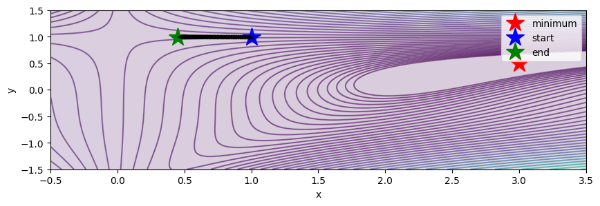

# Optimization on Ackley and Beale

Handwritten GD, momentum, RMSProp, Adam and Newton update rules, with PyTorch autograd derivatives on Ackley/Beale and trajectory plots.

## Saved evidence — not rerun

Saved contours and optimizer trajectories are present. No standardized scalar benchmark, common convergence table or multi-start success rate is printed.

All metrics are copied from uploaded outputs. This preparation did not execute training, generation, evaluation or existing numerical checks. Original zero-based cell indices are cited; the public copy adds a banner.



## Setup and source variants

Read DATA_REQUIREMENTS.md for exact datasets, helper modules, model IDs and missing checkpoints. Requirements list imports, **not a tested lockfile**. In a separate Python environment, from this folder:

```bash
python -m pip install -r requirements.txt
jupyter lab
```

Reading saved outputs requires no dataset or GPU download. Executing source may require platform-specific setup, external weights and substantial compute. Notebook package-install cells should be reviewed before running.

`revised.ipynb` contains selected static fixes and cleared outputs. It was not executed and may retain blockers in REVIEW.md; historical metrics do not apply to this revision.

## Recorded notebook status

24 code cells, 0 saved error outputs, 0 nonempty code cells without execution counts. Execution counts and absence of errors do not prove a clean sequential run. See REVIEW.md and ATTRIBUTION.md.
