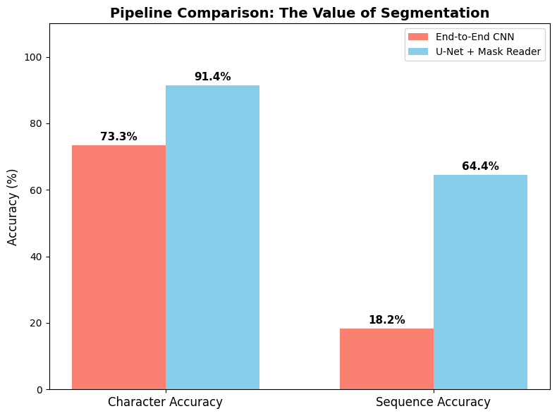

# Synthetic CAPTCHA Segmentation and Recognition

Synthetic five-digit CAPTCHA generation, MicroUNet pixel segmentation, a five-head sequence reader, raw-image baseline and end-to-end comparison.

## Saved evidence — not rerun

Segmentation training logs and qualitative outputs are stored. Cell 33 evaluates baseline and segmentation+reader on 500 newly synthesized examples and plots character/sequence accuracy. Numerical accuracy values are encoded in the plot rather than printed; this review does not invent values from it.

All metrics are copied from uploaded outputs. This preparation did not execute training, generation, evaluation or existing numerical checks. Original zero-based cell indices are cited; the public copy adds a banner.



## Setup and source variants

Read DATA_REQUIREMENTS.md for exact datasets, helper modules, model IDs and missing checkpoints. Requirements list imports, **not a tested lockfile**. In a separate Python environment, from this folder:

```bash
python -m pip install -r requirements.txt
jupyter lab
```

Reading saved outputs requires no dataset or GPU download. Executing source may require platform-specific setup, external weights and substantial compute. Notebook package-install cells should be reviewed before running.

`notebook.ipynb` retains the submitted computational source and historical outputs after publication cleanup. No revised algorithm variant is supplied.

## Recorded notebook status

17 code cells, 0 saved error outputs, 1 nonempty code cells without execution counts. Execution counts and absence of errors do not prove a clean sequential run. See REVIEW.md and ATTRIBUTION.md.
