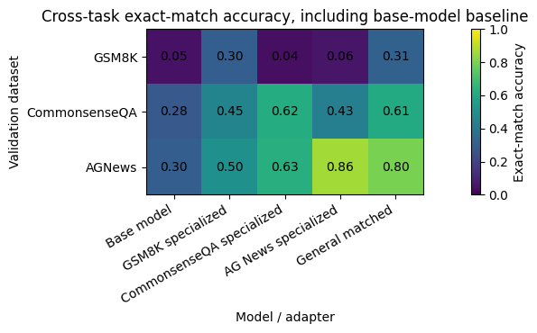

# Multi-Task LoRA Specialization and Transfer

Qwen2.5-0.5B-Instruct LoRA rank study and specialized/general adapters across GSM8K, CommonsenseQA and AGNews, with cross-task evaluation.

## Saved evidence — not rerun

Stored runs train ranks 4,16,64 on 300 CommonsenseQA examples. Rank 16 is selected. Specialized runs use four epochs/80 optimizer updates; the 900-example general adapter is configured for the same 80 updates (22). Rich transfer tables and figures are preserved; this review does not reconstruct a numeric leaderboard from Styler HTML.

All metrics are copied from uploaded outputs. This preparation did not execute training, generation, evaluation or existing numerical checks. Original zero-based cell indices are cited; the public copy adds a banner.



## Setup and source variants

Read DATA_REQUIREMENTS.md for exact datasets, helper modules, model IDs and missing checkpoints. Requirements list imports, **not a tested lockfile**. In a separate Python environment, from this folder:

```bash
python -m pip install -r requirements.txt
jupyter lab
```

Reading saved outputs requires no dataset or GPU download. Executing source may require platform-specific setup, external weights and substantial compute. Notebook package-install cells should be reviewed before running.

`notebook.ipynb` retains the submitted computational source and historical outputs after publication cleanup. No revised algorithm variant is supplied.

## Recorded notebook status

14 code cells, 0 saved error outputs, 1 nonempty code cells without execution counts. Execution counts and absence of errors do not prove a clean sequential run. See REVIEW.md and ATTRIBUTION.md.
