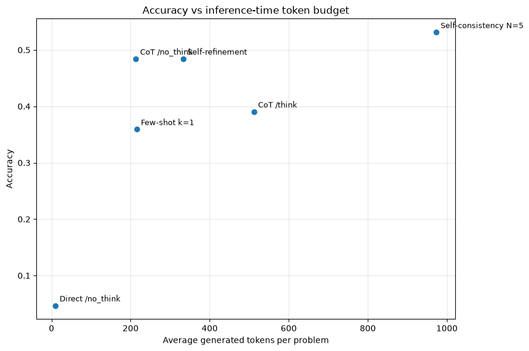

# LLM Inference Strategies on GSM8K

Qwen3-0.6B numeric-answer experiments: direct, CoT with/without thinking, five-sample self-consistency, one-shot prompting and refinement.

## Saved evidence — not rerun

On a stored 64-example GSM8K subset: Direct 0.046875; CoT /no_think 0.484375; CoT /think 0.390625; self-consistency N=5 0.53125; few-shot 0.359375; refinement 0.484375 (13–23). Self-consistency reports 973.5 generated tokens and 19.26 seconds per problem on average.

All metrics are copied from uploaded outputs. This preparation did not execute training, generation, evaluation or existing numerical checks. Original zero-based cell indices are cited; the public copy adds a banner.



## Setup and source variants

Read DATA_REQUIREMENTS.md for exact datasets, helper modules, model IDs and missing checkpoints. Requirements list imports, **not a tested lockfile**. In a separate Python environment, from this folder:

```bash
python -m pip install -r requirements.txt
jupyter lab
```

Reading saved outputs requires no dataset or GPU download. Executing source may require platform-specific setup, external weights and substantial compute. Notebook package-install cells should be reviewed before running.

`notebook.ipynb` retains the submitted computational source and historical outputs after publication cleanup. No revised algorithm variant is supplied.

## Recorded notebook status

15 code cells, 0 saved error outputs, 2 nonempty code cells without execution counts. Execution counts and absence of errors do not prove a clean sequential run. See REVIEW.md and ATTRIBUTION.md.
