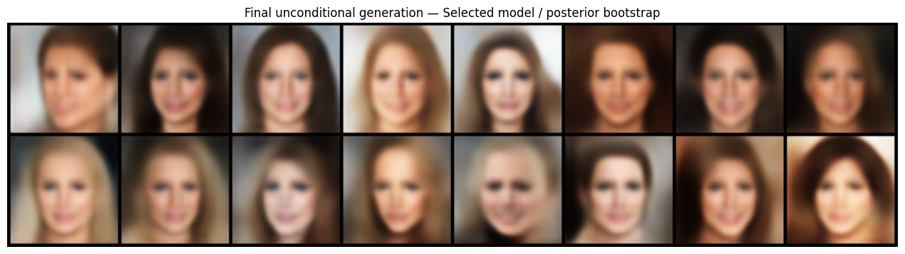

# Face VAE Reconstruction and Latent Analysis

CelebA face VAEs with core/skip/latent-skip variants, KL schedules, latent/attribute probing, reconstruction diagnostics and alternate generative priors.

## Saved evidence — not rerun

Core reconstruction PSNR 20.81 dB, SSIM 0.5583, MSE 0.03325 (67). Stored comparison gives U-Net Skip PSNR 22.769 and SSIM 0.720 (74). Stored 500-image feature FID: core standard prior 170.29, selected-model posterior bootstrap 134.86, learned GMM prior 156.67 (86).

All metrics are copied from uploaded outputs. This preparation did not execute training, generation, evaluation or existing numerical checks. Original zero-based cell indices are cited; the public copy adds a banner.



## Setup and source variants

Read DATA_REQUIREMENTS.md for exact datasets, helper modules, model IDs and missing checkpoints. Requirements list imports, **not a tested lockfile**. In a separate Python environment, from this folder:

```bash
python -m pip install -r requirements.txt
jupyter lab
```

Reading saved outputs requires no dataset or GPU download. Executing source may require platform-specific setup, external weights and substantial compute. Notebook package-install cells should be reviewed before running.

`revised.ipynb` contains selected static fixes and cleared outputs. It was not executed and may retain blockers in REVIEW.md; historical metrics do not apply to this revision.

## Recorded notebook status

49 code cells, 0 saved error outputs, 8 nonempty code cells without execution counts. Execution counts and absence of errors do not prove a clean sequential run. See REVIEW.md and ATTRIBUTION.md.
