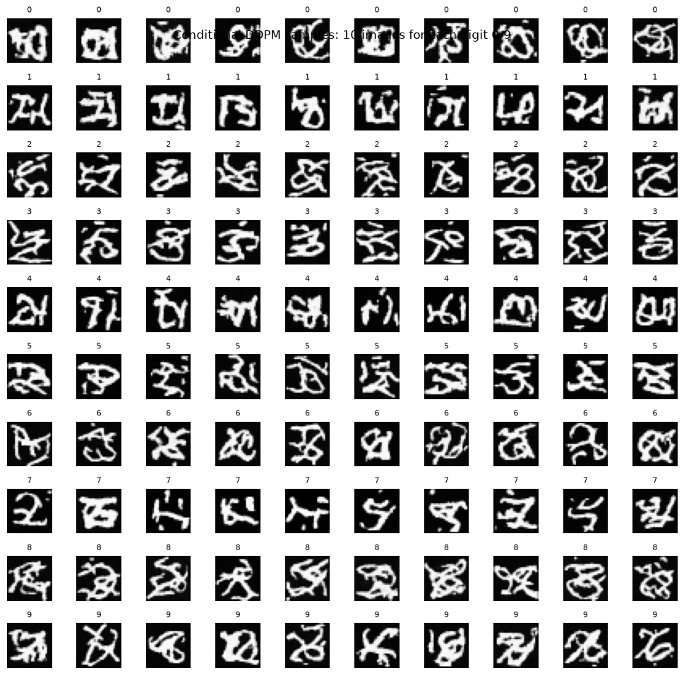

# MNIST DDPM and Classifier-Free Guidance

MNIST unconditional DDPM, time-conditioned U-Net, conditional denoising and classifier-free guidance; generated-digit grids and RBF-MMD comparison.

## Saved evidence — not rerun

Stored conditional epoch-5 average noise loss 0.056513 (74). Stored conditional-guided RBF-MMD² 0.133162 uses 256 real and 256 generated samples and bandwidth sigma 12.4739 (82). Both 100-step sampling and generated grids are present.

All metrics are copied from uploaded outputs. This preparation did not execute training, generation, evaluation or existing numerical checks. Original zero-based cell indices are cited; the public copy adds a banner.



## Setup and source variants

Read DATA_REQUIREMENTS.md for exact datasets, helper modules, model IDs and missing checkpoints. Requirements list imports, **not a tested lockfile**. In a separate Python environment, from this folder:

```bash
python -m pip install -r requirements.txt
jupyter lab
```

Reading saved outputs requires no dataset or GPU download. Executing source may require platform-specific setup, external weights and substantial compute. Notebook package-install cells should be reviewed before running.

`revised.ipynb` contains selected static fixes and cleared outputs. It was not executed and may retain blockers in REVIEW.md; historical metrics do not apply to this revision.

## Recorded notebook status

29 code cells, 0 saved error outputs, 0 nonempty code cells without execution counts. Execution counts and absence of errors do not prove a clean sequential run. See REVIEW.md and ATTRIBUTION.md.
