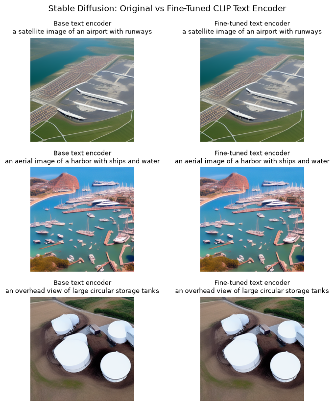

# CLIP Remote Sensing, LoRA and Retrieval

CLIP zero-shot RESISC45 analysis, prompt studies, LoRA adaptation, image retrieval and exploratory Stable Diffusion text-encoder transfer.

## Saved evidence — not rerun

Stored full-test CLIP Top-1 0.677937/Recall@5 0.946984 on 6,300 images (31/48). Best tested prompt ensemble 0.714127 (79). Stored fine-tuned Top-1 0.886984/Recall@5 0.996190 (107/109), after a training cell interrupted at 461/2363 batches (101).

All metrics are copied from uploaded outputs. This preparation did not execute training, generation, evaluation or existing numerical checks. Original zero-based cell indices are cited; the public copy adds a banner.



## Setup and source variants

Read DATA_REQUIREMENTS.md for exact datasets, helper modules, model IDs and missing checkpoints. Requirements list imports, **not a tested lockfile**. In a separate Python environment, from this folder:

```bash
python -m pip install -r requirements.txt
jupyter lab
```

Reading saved outputs requires no dataset or GPU download. Executing source may require platform-specific setup, external weights and substantial compute. Notebook package-install cells should be reviewed before running.

`notebook.ipynb` retains the submitted computational source and historical outputs after publication cleanup. No revised algorithm variant is supplied.

## Recorded notebook status

77 code cells, 2 saved error outputs, 3 nonempty code cells without execution counts. Execution counts and absence of errors do not prove a clean sequential run. See REVIEW.md and ATTRIBUTION.md.
